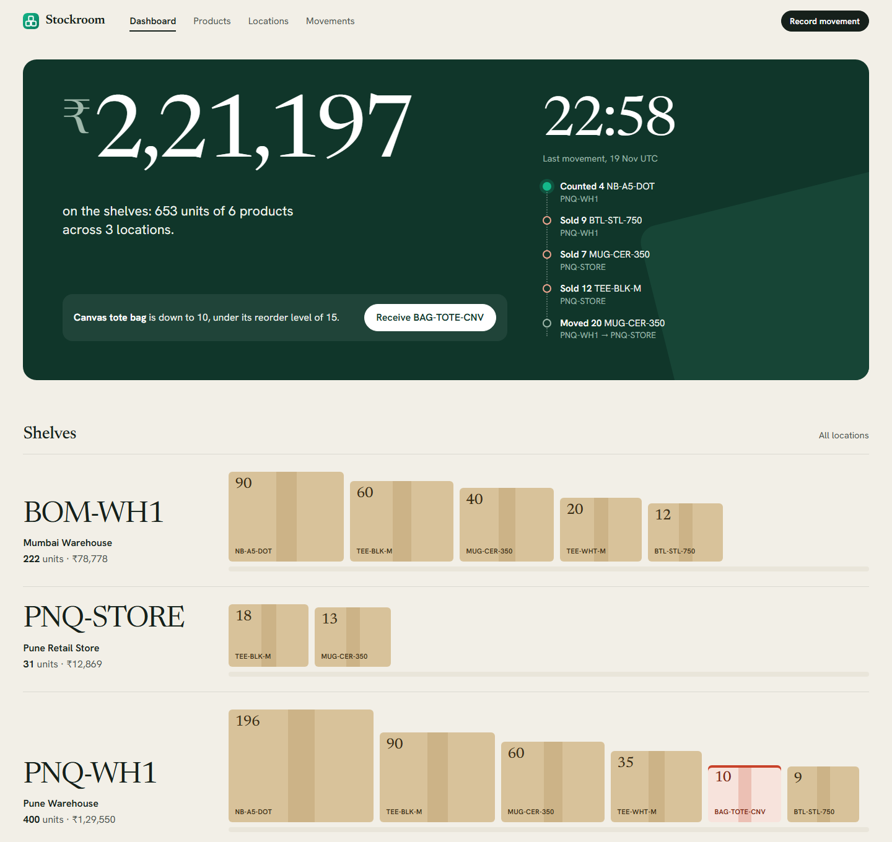
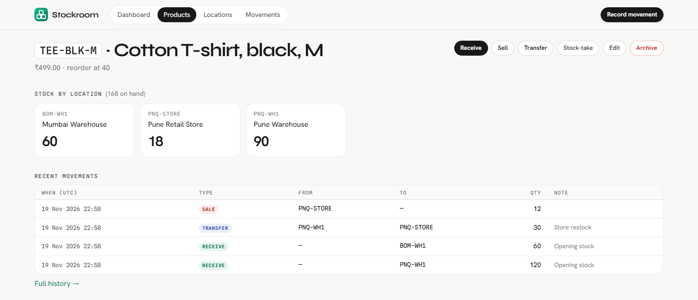

<p align="center"></p>

<h1 align="center">Stockroom</h1>

<p align="center"><b>Stock that adds up.</b><br>Multi-location inventory in C#, ASP.NET Core MVC, Entity Framework Core and SQL Server, with every stock movement on record.</p>

[](https://github.com/alok-kul5/stockroom-inventory/actions/workflows/ci.yml)

A small inventory management app: products, warehouses and stores, and every stock
movement between them. Built with **C#, ASP.NET Core MVC, Entity Framework Core and SQL
Server**, with a little vanilla JavaScript on top of a JSON API.



## What it does

| | |
|---|---|
| **Products** | SKU (unique, fixed once created), name, price, reorder level. Products with history are archived, never deleted, so the ledger never loses a reference. |
| **Locations** | Warehouses and stores, each with its own stock of every product. |
| **Movements** | *Receive* into a location, *sell* out of one, *transfer* between two, or *stock-take* to set the counted quantity. Every change writes one row to an append-only ledger. |
| **Dashboard** | Units on hand, stock value in ₹, products at or below their reorder level, and the latest movements. |
| **JSON API** | `GET /api/products?q=` (search with totals) and `GET /api/products/{id}/stock` (per location). The product page and the movement form fetch these and update the DOM. |



## Design decisions

- **The ledger is the source of truth.** `StockService` is the only code that changes stock.
  It updates the stock level and writes the movement row in **one `SaveChanges`**, so the
  two can't drift apart. A test runs 200 random operations and checks that every level equals
  its inflows minus its outflows.
- **No negative stock, enforced twice.** The service refuses to sell or transfer more than is
  on hand, and the database has `CHECK (Quantity >= 0)` on stock levels and `CHECK (Quantity > 0)`
  on movements.
- **Two clerks, one last item.** `StockLevel` has a `Version` concurrency token. If two requests
  read the same level and both try to sell from it, the second save fails with
  `DbUpdateConcurrencyException` and the user sees "Someone else changed this stock at the same
  moment". A test reproduces this with two `DbContext`s.
- **Server-side rules, client-side convenience.** The movement form hides the location fields a
  movement type doesn't need and shows live stock. The real validation is all on the server, and
  every page works without JavaScript.
- **Forms are protected** with ASP.NET antiforgery tokens (there's a test that a post without one
  is rejected) and use `[Bind]` lists so a form can't set fields like `IsArchived` or `Sku` on edit.

## Tests

```
dotnet test
```

29 tests, no SQL Server needed: they use **SQLite in memory**, which (unlike EF's in-memory
provider) enforces the unique indexes, check constraints and concurrency tokens.

- `StockServiceTests`: receive, sell, transfer and stock-take rules; rejected operations leave
  no trace; low-stock calculation; ledger reconciliation; the concurrency race.
- `WebAppTests`: boot the real app with `WebApplicationFactory`: every page renders, the API
  returns the right numbers, overselling through the form shows an error and changes nothing, a
  valid receipt redirects and updates stock, missing antiforgery tokens are rejected, duplicate
  SKUs are caught case-insensitively.

CI on GitHub Actions builds with warnings as errors, runs the tests, and fails if the EF model
has changes without a migration.

## Run it

Needs the **.NET 10 SDK** and **SQL Server** (Express or LocalDB, both free).

```
dotnet tool restore
dotnet run --project src/Inventory.Web -e ASPNETCORE_ENVIRONMENT=Development
```

The connection string in `src/Inventory.Web/appsettings.json` points at `.\SQLEXPRESS`. On first
start the app applies the EF Core migrations and seeds three locations and six products with an
opening stock history.

## Layout

```
src/Inventory.Web/
  Models/        Product, Location, StockLevel, StockMovement + view models
  Data/          InventoryDbContext, migrations, seed data
  Services/      StockService: every stock rule lives here
  Controllers/   Home, Products, Locations, Stock (MVC) and Api (JSON)
  Views/         Razor views
  wwwroot/js/    site.js: fetch + DOM updates for live stock
tests/Inventory.Tests/
```

---

<sub>One of seventeen projects by [Alok Kulkarni](https://alok.is-a.dev): [Hearth](https://github.com/alok-kul5/hearth-iot) home sensors · [Headway](https://github.com/alok-kul5/headway-transit) transit data · [Vigil](https://github.com/alok-kul5/vigil-soc) security triage · [Loupe](https://github.com/alok-kul5/loupe-vision) defect inspection · [Kharcha](https://github.com/alok-kul5/kharcha-finance) personal finance · **Stockroom** inventory · [Quietwire](https://github.com/alok-kul5/quietwire-villa) smart home design · [Canopy](https://alok.is-a.dev/canopy/) coffee storefront · [Picket](https://github.com/alok-kul5/picket) detection rules · [Warden](https://github.com/alok-kul5/warden-iac) cloud IaC scanning · [Marquee](https://github.com/alok-kul5/marquee-recs) recommendations · [Kestrel](https://github.com/alok-kul5/kestrel) fraud detection · [Almanac](https://github.com/alok-kul5/almanac-forecast) demand forecasting · [Quarry](https://github.com/alok-kul5/quarry-sql) data questions in plain English · [Quire](https://github.com/alok-kul5/quire) cited answers about Python · [Transit](https://github.com/alok-kul5/transit-mumbai) Mumbai trains · [Pulse](https://github.com/alok-kul5/pulse-habits) habit tracker.</sub>
